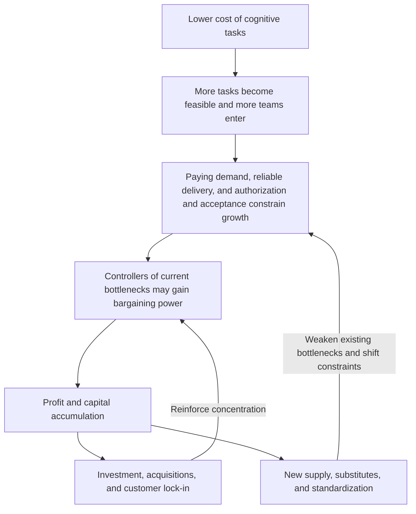

# Bottleneck Migration and Value Capture in the AI Revolution

> As cognitive capabilities become easier to replicate, economic growth becomes increasingly constrained by conditions that expand more slowly. Those who remove these constraints create value; those who control customers, critical resources, and transaction terms may be able to retain the returns over time.

This project presents a testable mechanism framework and an illustrative model. It has not yet been validated with data and is not an industry forecast or a prediction of startup success rates.

For the complete model, assumptions, evidence audit, startup outcome definitions, and conditional scenarios for 2027–2028, see the **[full paper](ai-bottleneck-theory-v01.md)**.

## Bottlenecks form a changing network of power

Chips, models, platforms, applications, and trust infrastructure have no permanently fixed hierarchy. The key question is: in a particular business at a particular time, what missing condition prevents other inputs from producing more results?

- **Concentration:** Profitable incumbents can invest, acquire competitors, and control distribution.
- **Diffusion:** High profits attract substitutes and new supply; standardization lowers entry and switching costs.

Neither inevitable concentration nor inevitable democratization should be assumed. The research question is: under what conditions does one force dominate?

## A minimal operational model

Choose a task with consistent quality, deadline, and accountability requirements. Measure all capacities in completed tasks per month:

$$
Q^{\max}=\min\{D(p),K,T\}
$$

| Variable | Meaning |
| --- | --- |
| D(p) | Reachable demand willing to pay at the current price |
| K | Reliable delivery capacity supported by technology and resources |
| T | Organizational capacity to authorize, supervise, accept results, and accept responsibility arrangements |
| Q max | Maximum transaction volume; actual volume may be lower |

In the simplified case of operating at this limit:

$$
\pi=(p-c)Q^{\max}-F=mQ^{\max}-F
$$

Here, p is the price per completed task; c includes variable costs such as model calls, retries, and human review; F is fixed cost; and m is contribution margin per task.

**Capability growth → transaction volume growth → profit growth: every step requires additional conditions.** More agent calls do not necessarily mean larger end-customer budgets.

This minimum model is a short-run approximation with strictly complementary inputs. It should not be treated as a production function for the entire economy.

## Illustrative scenarios

All numbers are illustrative parameters, not industry forecasts. The price is fixed at $20 per task and fixed costs at $2,000 per month.

| Scenario | D | K | T | m ($/task) | Q max (tasks/month) | Profit ($/month) |
| --- | ---: | ---: | ---: | ---: | ---: | ---: |
| Baseline | 1,000 | 600 | 300 | 6 | 300 | -200 |
| Increase delivery capacity only | 1,000 | 1,200 | 300 | 6 | 300 | -200 |
| Increase authorization and acceptance capacity from baseline | 1,000 | 600 | 600 | 6 | 600 | 1,600 |
| Lower contribution margin | 1,000 | 600 | 600 | 2 | 600 | -800 |
| Demand becomes the bottleneck | 200 | 1,500 | 1,500 | 6 | 200 | -800 |

Capacity improvements also require investment. These scenarios exclude the incremental costs of capacity expansion or governance projects.

## Priority questions to test

1. Does removing authorization constraints increase actual transactions?
2. When delivery costs fall, who captures the gains: application companies, customers, upstream suppliers, or distributors?
3. When platforms offer similar features, do customers continue renewing independent solutions?

The central research question is which conditions remain scarce as cognitive capabilities expand, and through what mechanisms that scarcity becomes returns and power.

## Pension capital and ownership of AI returns

The [regional research note](pension-capital-and-ai.md) extends the model to pension and sovereign capital across six jurisdictions in five regional panels. It compares investment routes, separates policy commitments from deployed assets, and asks how institutional ownership transmits AI returns to households. Checked figures, attributed reporting, and pending claims are identified separately.
