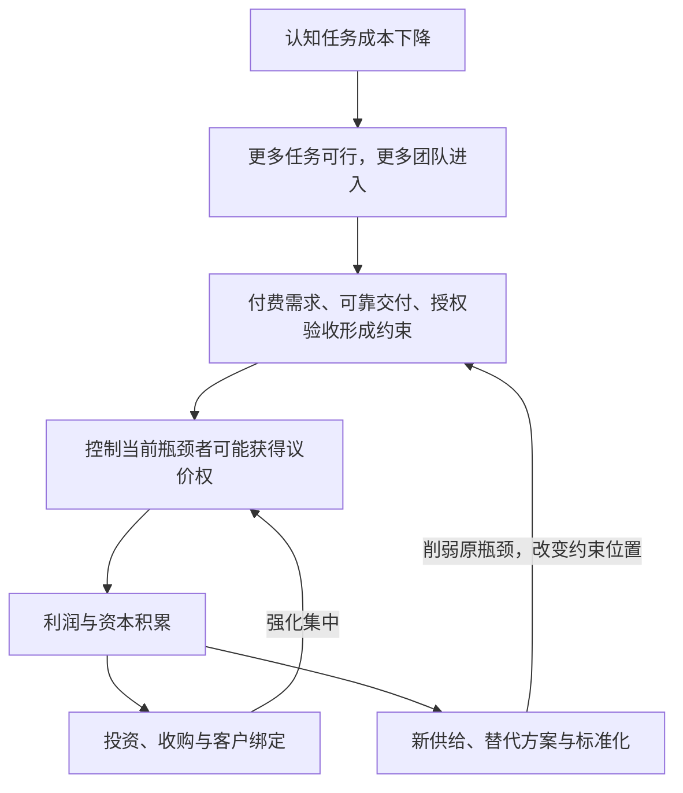

# AI革命的瓶颈迁移与收益分配模型

**v0.1 · 2026-10-28**

> 当认知能力变得更容易复制，经济增长会越来越受那些扩张较慢的条件约束。解除这些约束的人创造价值；能够控制客户、关键资源和交易条件的人，才可能持续留下收益。

本项目是一套可检验的机制框架与示意模型，尚未经过数据验证，不是行业预测或创业成功率预测。

完整模型、公式假设、证据审计、创业结局定义和2027—2028条件情景见 **[模型全文](ai-bottleneck-theory-v01.md)**。

## 瓶颈是一张变化的权力网络

芯片、模型、平台、应用、信任层没有永久固定的高低顺序。关键问题是：在某个时间、某个业务里，缺少什么会让其他投入无法产生更多结果？

- **集中力量：**已经赚到钱的人，更有能力投资、收购、控制渠道。
- **扩散力量：**高利润吸引替代方案与新供给，标准化降低进入和切换成本。

“最终一定集中”与“最终一定民主化”都不能预设。研究问题是：什么条件让其中一股力量占上风？

## 最小可运算模型

选择质量、时限和责任标准一致的任务，容量统一按“件/月”计量：

$$
Q^{\max}=\min\{D(p),K,T\}
$$

| 变量 | 含义 |
| --- | --- |
| D(p) | 当前价格下愿意付费且能触达的需求 |
| K | 技术与资源支持的可靠交付能力 |
| T | 组织能够授权、监督、验收并接受责任安排的能力 |
| Q max | 可成交量上限，实际成交可能更低 |

在按上限交付的简化情景下：

$$
\pi=(p-c)Q^{\max}-F=mQ^{\max}-F
$$

其中，p是单价；c包含模型调用、重试、人工复核等变动成本；F是固定成本；m是单位贡献利润。

**能力增长 → 可成交量增长 → 利润增长，每一步都需要额外条件。** Agent调用次数增长，也不等于最终付费预算增长。

这个最小值模型是短期严格互补近似，不能直接作为整个经济的生产函数。

## 示意情景

全部数字均为示意参数，不是行业预测。固定售价20美元/件，固定成本2,000美元/月。

| 情景 | D | K | T | m（美元/件） | Q max（件/月） | 利润（美元/月） |
| --- | ---: | ---: | ---: | ---: | ---: | ---: |
| 默认 | 1,000 | 600 | 300 | 6 | 300 | -200 |
| 只提高交付能力 | 1,000 | 1,200 | 300 | 6 | 300 | -200 |
| 从默认提高授权验收能力 | 1,000 | 600 | 600 | 6 | 600 | 1,600 |
| 单位贡献利润下降 | 1,000 | 600 | 600 | 2 | 600 | -800 |
| 需求成为瓶颈 | 200 | 1,500 | 1,500 | 6 | 200 | -800 |

改善容量本身也需要投入；上述情景暂未计入扩容或治理项目的增量成本。

## 优先检验的问题

1. 解除授权限制后，真实成交是否增加？
2. 交付成本下降后，收益由应用公司、客户、上游还是渠道获得？
3. 平台提供类似功能后，客户是否仍为独立方案续费？

本模型最值得研究的是：认知能力扩张后，哪些条件仍然稀缺，这种稀缺又通过什么机制变成收益与权力。
